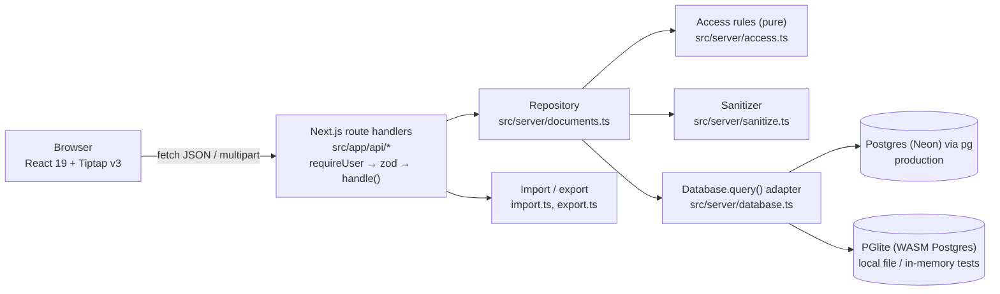

# Architecture note

## What I prioritized, and why

With 4-6 hours, I optimized for a **complete, trustworthy core loop** over breadth: create → format → autosave → reopen → share → see the right permissions as another user. Every requirement in the brief works end to end, and the server-side rules behind it (permissions, sanitizing, import, export, validation) are covered by automated tests. Permissions got the most care, because a document tool that leaks or mis-scopes access is worse than one that lacks a feature.

What I deliberately did **not** build: real-time co-editing (CRDT / Yjs), presence, comments, version history, real authentication, attachments, PDF export and a translated Arabic UI. Each is a meaningful project on its own. Doing any of them half-way would have cost the polish of the core loop.

## System overview

Route handlers are thin: resolve the user from the session cookie, validate the body with zod, call one repository function, and return JSON. The `handle()` wrapper maps `HttpError` and `ZodError` to `{ error }` with the right status (400 / 401 / 403 / 404), and anything unexpected to a generic 500.

## Data model

| Table | Columns | Notes |
|---|---|---|
| `users` | `id`, `name`, `email` (unique) | Three seeded demo users |
| `documents` | `id`, `owner_id` → users, `title`, `content` (sanitized HTML), `created_at`, `updated_at` | Indexed on `owner_id` |
| `document_shares` | `document_id` → documents, `user_id` → users, `role` (`viewer` \| `editor`), `created_at` | PK `(document_id, user_id)`; indexed on `user_id`; cascades on delete |

The owner is a column on `documents`, not a share row, so ownership can never be revoked or duplicated. Sharing is an upsert on the composite key: re-sharing changes the role. The schema and seed run idempotently on boot (`CREATE TABLE IF NOT EXISTS`, `ON CONFLICT DO NOTHING`), so there is no separate migration step.

## Key decisions and tradeoffs

| Decision | Why | Tradeoff accepted |
|---|---|---|
| **Postgres in prod (Neon), PGlite locally and in tests** | Vercel's filesystem is ephemeral, so SQLite would lose data. PGlite gives the same SQL dialect with zero local setup, and tests run against a real Postgres engine. | Two drivers to support. Mitigated by a one-method adapter. |
| **Thin `Database.query()` adapter, no ORM** | About 10 queries. An ORM would add build, codegen and migration weight for no gain. | Hand-written SQL and row types. Fine at this size; I'd revisit past ~30 queries. |
| **Store content as sanitized HTML** (not ProseMirror JSON) | Import (marked / mammoth) and export (turndown) share one format. The editor schema normalizes on load anyway. A server-side sanitizer makes stored content safe whatever the client sends. | Less structured than JSON for future features like comments anchored to nodes or CRDT sync. |
| **Access checks inside the repository**, rules in a pure module | A route cannot forget a check: every repository function takes the acting user and authorizes first. The pure rules are trivially unit-tested. | Each call does one extra lookup. Negligible here. |
| **404 for no access, 403 for insufficient role** | Users who can't see a document can't confirm it exists by probing ids. Users who can see it get an honest "not allowed". | Slightly less explicit errors for outsiders, which is intended. |
| **Mocked auth via httpOnly cookie** | Lets reviewers switch between owner / editor / viewer in seconds. Only `src/server/session.ts` would change for real auth. | Not secure identity; acceptable and clearly labeled for a demo. |
| **Debounced autosave (~800 ms), last write wins** | Feels like Google Docs without a save button; simple and predictable. | Concurrent edits by two users can overwrite each other. See limitations. |
| **Import creates a new document** | Predictable; never destroys existing content. | No "insert file into current doc" yet. |

## Security model

- **Identity:** mocked. The session cookie (`ajaia_uid`) is `httpOnly`, `sameSite=lax`, and `secure` in production. Every API route except `/api/users` and `/api/session` calls `requireUser()` and returns 401 without a session.
- **Authorization:** `access.ts` defines owner = read / edit / rename / delete / share, editor = read / edit / rename, viewer = read. `documents.ts` loads the document with the caller's share row and checks the action before any read or write. Listing only returns documents the user owns or has a share on. Export uses the same read check.
- **Content safety:** every write (editor save, create, import) passes through an allow-list sanitizer (`sanitize-html`): only the tags the editor supports, `dir` attributes, and `http(s)` / `mailto` links forced to `rel="noopener noreferrer nofollow"`. Scripts, styles and event handlers are stripped, which closes stored XSS.
- **Input limits:** zod at the boundary, a 200-character title, 1 MB content (measured after sanitizing), 5 MB upload, a file-type allow-list (`.txt`, `.md`, `.docx`), and friendly errors for empty, corrupt or unsupported files.
- **SQL:** parameterized queries only.

## Known limitations

- **Concurrent edits:** last write wins. Two people editing the same document at the same time can overwrite each other's changes. There is no live sync or presence.
- **Auth is mocked:** anyone can act as any seeded user. Only the three seeded users can be shared with.
- **No version history** and no undo across sessions.
- **Import fidelity:** `.docx` keeps headings, emphasis and lists; images, tables and complex layout are dropped by the sanitizer.
- **RTL** is content-level only (`dir="auto"` per paragraph); the app chrome is English-only.

## Next steps (2-4 more hours)

1. **Optimistic concurrency:** send the `updated_at` the client loaded; return 409 on mismatch and let the user reload or overwrite. This is a small change in `updateDocument`.
2. **Real-time collaboration:** Yjs + Hocuspocus with the Tiptap collaboration extension, persisting snapshots to the same `documents` table. This also gives presence cursors.
3. **Version snapshots:** a `document_versions` table written on a debounce, with a restore action.
4. **Real auth:** Auth.js magic link, replacing only `session.ts`.
5. **Playwright e2e** of the full share flow (Alice shares → Bob edits → Sara is read-only).
